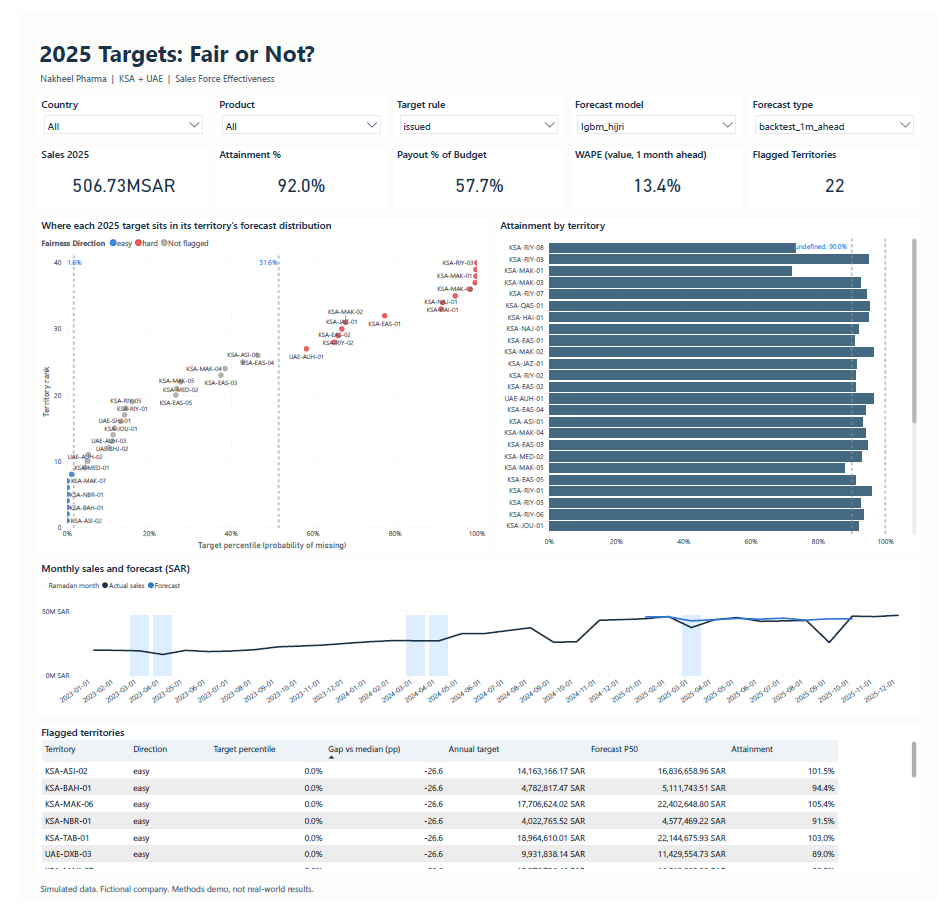

# Fair Targets: Ramadan-Aware Forecasting and Incentive Fairness for a GCC Pharma Affiliate

Sales forecasting, target-fairness scoring and incentive simulation for a simulated GCC pharma affiliate, with a SQL warehouse, a Hijri-calendar-aware forecast and a Power BI dashboard.

> **Data honesty:** all sales, rep, target and payout data is **simulated** for a fictional company ("Nakheel Pharma"), because rep-level pharma data is confidential everywhere. Market-level inputs (regional population, diabetes prevalence, prices, market growth) are calibrated to public sources cited in [`docs/calibration.md`](docs/calibration.md); any figure that could not be verified is marked there as an **assumption**. Results show how well the **methods** work, not real-world forecast accuracy or real incentive outcomes. Nakheel Pharma and its brands do not exist.



**Quick links:** [memo to the sales force effectiveness lead](reports/REPORT.md) · [effect scorecard](reports/SCORECARD.md) · [Power BI file](reports/powerbi/fair_targets.pbix) · [calibration sources](docs/calibration.md)

## Problem

A GCC pharma affiliate sets annual sales targets for about 40 reps. Two things go wrong every year:

1. **Forecasts miss around Ramadan.** Ramadan moves about 11 days earlier each Gregorian year, so a model that learns "March is weak" is wrong the next year.
2. **Targets feel unfair.** "Last year + X%" punishes reps after a strong year and rewards territories that had a vacancy.

**The central idea:** a target is fair when every rep has about the **same probability of hitting it**. A probabilistic forecast gives each territory's target a percentile; a target at the P85 of its forecast is much harder than one at the P50. Territories far from the median are flagged, and the flags are scored against a hidden answer key.

## Questions

| # | Question |
|---|---|
| Q1 | Which forecast model should we use? Does it beat seasonal naive on WAPE and bias, by product? |
| Q2 | Does a Hijri-aware model beat a Gregorian-only model around Ramadan and Eid? |
| Q3 | Which territories have unfair targets, and how far off are they? |
| Q4 | "Last year + X%" vs potential-based targets: which gives lower payout-cost risk, a fairer payout spread (Gini) and a tighter fairness spread? |

## Simulated world

"Nakheel Pharma" sells a cardiometabolic portfolio in **KSA and the UAE**, with about 40 reps (one per territory, mapped to real regions) over **36 months**: years 1 and 2 are history and year 3 is the target year.

| Product (fictional) | Role | Story planted |
|---|---|---|
| Glucora (DPP-4 inhibitor) | Mature brand | **Generic entry** partway through history, then erosion |
| Semavia (GLP-1 injectable) | Launch | **Launch ramp** plus **stock-out months** where recorded sales understate demand |
| Cardivex (statin) | Stable control | Seasonality only |

**Territory potential** = regional population × diabetes prevalence × a price/market-size factor (sources in `docs/calibration.md`).

**Planted effects (hidden answer key):** Ramadan and Eid dips on the Hijri calendar, the Semavia launch ramp, Semavia stock-outs, Glucora generic entry, rep vacancies of 2 to 4 months, and about 5 unfairly targeted territories created by realistic mechanisms (last year + X% after a vacancy year, a new account missing from the base year, manual top-down uplifts). The generator writes `data/raw/answer_key.json`; only the final scoring step (`src/fairtargets/scorecard.py`) reads it, and a test fails if any other module references it.

**Realistic messiness in the raw feed:** late files, duplicate rows, valid negative returns (kept, not dropped) and restatements (the latest file wins).

## Approach

1. **Seeded generator** (`src/fairtargets/generator.py`): one seed produces the monthly feed files, rep and territory master data, year-3 targets and the answer key.
2. **SQL warehouse** (DuckDB, `sql/`):
   - `01_load` loads the raw files as delivered
   - `02_validate` checks duplicates, restatements, late files, negatives against the returns flag and orphan keys, and writes a data-quality summary
   - `03_fact` builds `fact_sales` (rep × territory × product × month) and `fact_targets`
   - `04_dims` builds the dimensions, including `dim_date` with Hijri month, Ramadan-day share, Eid days and KSA/UAE holidays
   - `05_kpi_views` computes attainment vs target, payout (threshold, linear band, cap) and like-for-like growth
3. **Forecasting ladder:** seasonal naive → ETS → a global LightGBM with lag, level, lifecycle, vacancy, Gregorian and Hijri features. Rolling-origin backtest (origins at months 24 to 33, 1 to 3 months ahead), with WAPE and bias by product. The Gregorian-only and Hijri-aware versions are compared overall and in Ramadan/Eid months.
4. **Fairness:** a year-3 forecast distribution per territory (point forecast scaled to the national budget, with a spread from bootstrapped backtest errors). Each target gets a percentile, and territories far from the median are flagged using a threshold set before scoring.
5. **Incentive simulation:** "last year + X%" vs a potential-based split, compared over 10,000 Monte Carlo years on payout cost (mean and P90 vs budget), payout Gini and fairness spread.
6. **Scoring:** precision and recall of the fairness flags, and recovery of every planted effect, against the answer key.
7. **Power BI:** a star schema exported to `reports/powerbi/`, with DAX in `MEASURES.md`, the layout in `LAYOUT.md`, and 22 checks against the warehouse in `VALIDATION.md` (all pass).

## Results (seed 42; every number from `reports/results/`)

**Data validation.** The feed has 29,134 rows in 37 delivery files. The SQL validation quarantined 14 invalid rows (8 negative sales, 6 unknown product codes), removed 200 duplicates, resolved 117 restatements and kept 4,034 valid negative returns. The resulting fact table equals the true ledger to the cent (tested).

**Forecasting.** Rolling-origin backtest, 3,600 forecasts per model, 1 to 3 months ahead:

| Model | WAPE | Bias | WAPE in Feb to Apr 2025 (Ramadan/Eid) |
|---|---|---|---|
| Seasonal naive | 27.0% | +1.5% | 31.5% |
| ETS | 12.5% | +1.8% | 15.1% |
| LightGBM, Gregorian only | 11.1% | +1.3% | 12.1% |
| LightGBM, Hijri-aware | **10.4%** | +2.2% | **10.3%** |

The 12-month recursive LightGBM forecast overshot 2025 by 26.5%, mainly on Semavia, so target setting uses it only after scaling to the national budget.

**Effect recovery.** 5 of 6 planted effects were recovered, along with every data-quality problem:
- Ramadan daily effect: estimated 0.87× vs 0.85× planted
- Generic entry month: 20 vs 20
- Stock-out months: 3 of 3 found, no false flags
- Vacancy effect: 0.654× vs 0.65×

**Unfair targets: partially recovered.** All 5 planted territories were flagged, each in the correct direction, but 22 flags in total means 23% precision. The cause is overconfident forecast ranges: only 15% of actual 2025 territory totals fell inside P10 to P90. The first run, without budget scaling, caught only 1 of 5; that change is disclosed in the memo.

**Incentive rules** (10,000 simulated years):

| | Last year + X% | Potential-based |
|---|---|---|
| Payout Gini | 0.10 | 0.37 |
| Reps on zero payout | 0.3% | 25.2% |
| Fairness spread (IQR of target percentiles) | 73 pp | 100 pp |

In this simulation the pure potential-based split is worse, so the memo recommends a corrected "last year + X%" rule.

**Power BI.** The dashboard reproduces the warehouse figures exactly (`reports/powerbi/VALIDATION.md`): 2025 sales SAR 506.73M at 92.0% attainment, payout at 57.7% of the bonus budget, and 22 flagged territories under the issued targets. Its WAPE card is value-weighted and one month ahead (13.4% for the Hijri-aware LightGBM vs 46.1% for seasonal naive), so it differs from the unit-based WAPE in the table above by design.

## Primary vs secondary sales (not modelled)

**Primary sales** are what the affiliate invoices to its distributor; **secondary sales** are what the distributor sells on to pharmacies and hospitals. The gap is distributor inventory, which can swing at quarter-end. Reps are usually measured on secondary sales and supply planning works on primary, so this project simulates secondary sales only.

## Limitations

- Everything is simulated. Planted effects are cleaner than reality, and having an answer key makes recovery easier than in practice.
- Results are for one seed (42).
- The forecast intervals come from a one-month-error bootstrap and are too narrow for a 12-month horizon, which is what limits fairness-flag precision.
- The Power BI file imports the CSVs from absolute paths. After cloning, repoint the sources in Power Query before refreshing.

## Future work

- Calibrated 12-month forecast intervals and results across several seeds.
- Hierarchical forecast reconciliation (territory → region → country).
- Primary vs secondary sales and distributor inventory; tender/institutional channel; call activity and HCP deciles.
- Forecast value added (FVA) of a management overlay.

## Project structure

```
data/calibration/  public inputs: regions.csv, country_diabetes.csv, sfda_reference_prices.csv
data/raw/          generator output + answer_key.json (git-ignored, regenerated)
data/clean/        warehouse.duckdb (git-ignored, regenerated)
docs/              calibration.md
sql/               01_load  02_validate  03_fact  04_dims  05_kpi_views
src/fairtargets/   config  calibration  calendar  generator  warehouse  forecast  targets
                   incentives  effects  figures  export_powerbi  scorecard  run_all
scripts/           extract_sfda_prices.py (reference prices from the SFDA drug list)
tests/             generator, calendar, validation, forecast, incentives, answer-key isolation (51 tests)
reports/           REPORT.md (memo), SCORECARD.md, figures/, results/
reports/powerbi/   fair_targets.pbix, star-schema CSVs, MEASURES.md, LAYOUT.md, VALIDATION.md
```

## Run it

```bash
python -m venv .venv
source .venv/bin/activate        # Windows: .\.venv\Scripts\Activate.ps1
pip install -r requirements.txt
pip install -e .

python -m fairtargets.run_all --seed 42    # about 1 minute; regenerates data and every output
pytest
```

## Tech

Python, DuckDB (SQL), pandas, statsforecast (ETS), LightGBM, SciPy, hijridate (Umm al-Qura calendar), holidays, matplotlib, pytest, Power BI (DAX).
