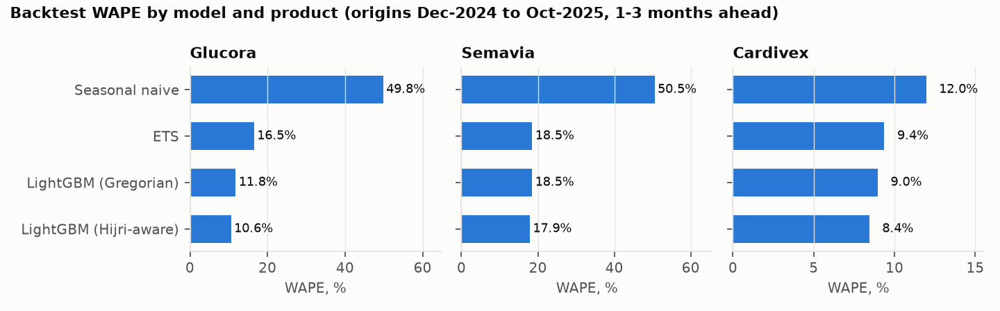
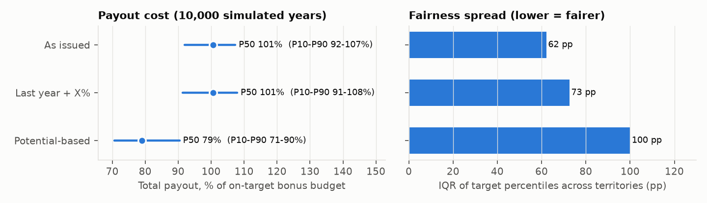
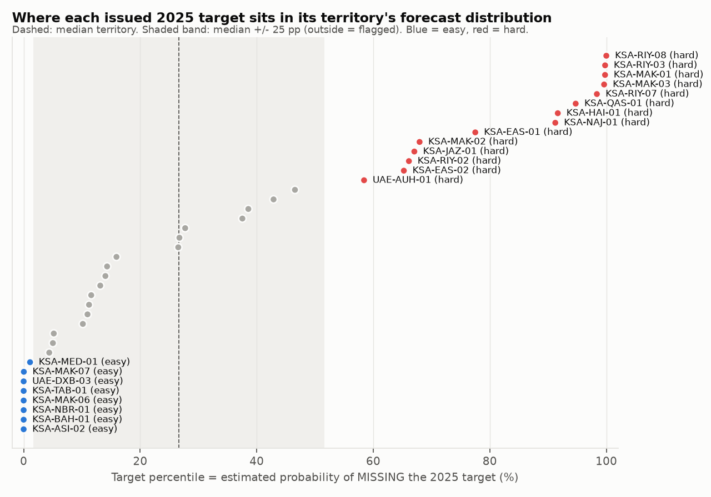

> **Simulated data.** "Nakheel Pharma" and its brands are fictional. Sales, targets and payouts are simulated from one seed (42) and calibrated to public sources ([`docs/calibration.md`](../docs/calibration.md)). The numbers below show how well the **methods** work on that simulation. They are not real-world accuracy or real incentive outcomes. Every number comes from `python -m fairtargets.run_all --seed 42` (files in `reports/results/`).

# Memo: 2025 forecasting and target setting

**To:** Head of Sales Force Effectiveness, Nakheel Pharma (KSA + UAE)
**Re:** Which forecast to use, how to set targets, and which territories to fix

## Summary

1. **Forecast model:** use the **Hijri-aware LightGBM** for 1–3-month forecasts. Its WAPE is **10.4%**, against 27.0% for seasonal naive, 12.5% for ETS and 11.1% for the same model without Hijri features. Do **not** use its raw 12-month output as a plan number: it overshot 2025 by **26.5%**.
2. **Targets:** keep **"last year + X%"** as the base, but correct the base year for vacancies and new accounts, and stop manual top-down uplifts. A pure **potential-based** split was worse in this simulation:
   - payout Gini 0.37 vs 0.10
   - 25% vs 0.3% of reps on zero payout
3. **Territories:** the fairness check flagged **22 of 40** territories. All 5 territories with planted unfair targets are among them, each with the right direction (easy or hard). But 17 flags are false alarms, because the forecast ranges are too narrow. **Use the list as a review queue sorted by gap, not as an automatic rule.**

## 1. Which forecast model to use

**How it was tested:** rolling-origin backtest. The forecast start month moves from Dec 2024 to Oct 2025, forecasting 1–3 months ahead each time: 40 territories × 3 products, 3,600 forecasts per model. Months detected as stock-outs were smoothed out of the *training* data only; accuracy is always scored against recorded sales.

| Model | WAPE | Bias | WAPE, Feb–Apr 2025 (Ramadan + Eid al-Fitr) | WAPE excl. stock-out month |
|---|---|---|---|---|
| Seasonal naive (baseline) | 27.0% | +1.5% | 31.5% | 27.1% |
| ETS | 12.5% | +1.8% | 15.1% | 11.5% |
| LightGBM, Gregorian calendar only | 11.1% | +1.3% | 12.1% | 10.3% |
| **LightGBM, Hijri-aware** | **10.4%** | +2.2% | **10.3%** | **9.5%** |

**Findings**
- **All three models beat seasonal naive on every product.** Naive fails on Glucora (WAPE 49.8%) because generic entry breaks "same month last year". It fails on Semavia (50.5%) because the launch ramp does the same.
- **The Hijri features help most around Ramadan** (10.3% vs 12.1% WAPE in Feb–Apr 2025), because Ramadan moved from mostly April (2023) to all of March (2025). Their share of the model's split gain is modest (5.6%).
- **The best model is slightly more biased:** +2.2% vs +1.3% for the Gregorian version. Watch it in monthly reviews.
- **Semavia is the weak spot for every model:** Hijri LightGBM WAPE 17.9%, bias +12.0%. One reason is the Sep 2025 stock-out, which no model can foresee. Another is that launch momentum is hard to extrapolate. Cardivex (8.4%) and Glucora (10.6%) are well forecast.
- **Accuracy drops slowly with horizon:** Hijri LightGBM WAPE is 9.9% at 1 month, 10.3% at 2 and 11.1% at 3.

**Do not use the 12-month LightGBM output as a plan number.** Forecast recursively from Dec 2024, it put 2025 sales **26.5%** above actual. Semavia was +40.6% (the model kept compounding launch-phase growth) and Glucora +13.3% (it under-predicted generic erosion). For target setting, use the forecast only to **split** the national budget across territories and to measure each territory's uncertainty (section 2).

## 2. How to set targets

**Definition:** a target is fair when each rep has about the same probability of hitting it.

**Method**
1. Forecast each territory's 2025 sales using data up to Dec 2024 only.
2. Scale the territory forecasts so each product sums to the national budget.
3. Simulate 10,000 possible years from past forecast errors.
4. Read where each target sits in its territory's distribution. That position is the **target percentile**: the probability of missing the target.
5. Flag territories more than 25 pp from the median territory. This threshold was set before any results.

**Two target-setting rules compared.** Both split the same national product budgets. "Issued" means the targets actually sent out, including manager edits.

| | As issued | Last year + X% | Potential-based |
|---|---|---|---|
| Fairness spread (IQR of target percentiles) | 62 pp | 73 pp | 100 pp |
| Territories flagged | 22 | 25 | 38 |
| Simulated payout cost, mean (P90), % of bonus budget | 100% (107%) | 100% (108%) | 80% (90%) |
| Simulated payout Gini | 0.12 | 0.10 | 0.37 |
| Simulated share of reps with zero payout | 2.9% | 0.3% | 25.2% |
| **Actual 2025:** payout cost, % of budget | 57.7% | 45.2% | 44.0% |
| **Actual 2025:** payout Gini | 0.26 | 0.40 | 0.63 |
| **Actual 2025:** reps with zero payout | 7 | 13 | 23 |

**Recommendation**
- **Do not switch to a pure potential-based split.** Territory potential (adults with diabetes) does not capture how much of it each territory can realistically convert: access and rep skill vary. A pure split leaves 25% of reps out of the money in a typical year and makes payouts much less equal.
- **Keep "last year + X%", but fix its known failure modes before issuing targets:**
  1. **Restate the base year** for months a territory was vacant. Vacancies cut sales to about 0.65× (estimated 0.654, 95% CI 0.636–0.674).
  2. **Restate it for new accounts** that opened partway through the base year.
  3. **Stop manual top-down uplifts.** The issued 2025 targets match the "last year + X%" formula in 38 territories. In KSA-RIY-08 and KSA-MAK-01 they are exactly 1.25× the formula on every product. Those two finished 2025 with the lowest attainments in the country (73.2% and 72.1%).
- **Expect a cost miss when the plan is missed.** Actual 2025 payout cost was only 57.7% of the bonus budget because national sales finished at **92.0%** of plan. Semavia reached 89.7%, after the Sep 2025 stock-out. The simulation centres on the plan, so it does not include that risk.
- **Add an event-relief rule** for stock-outs and vacancies. UAE-SHJ-01 lost its rep from May to Jul 2025 and finished at 84.0%. Both reps who held it in 2025 get zero payout.

## 3. Which territories to adjust

These are the flagged issued targets, sorted by the gap between the target and the territory's budget-scaled forecast median (P50). Every flag sits outside the median ± 25 pp band.

| # | Territory | Direction | Target vs forecast P50 | Target percentile (P miss) | Actual 2025 attainment |
|---|---|---|---|---|---|
| 1 | KSA-MAK-06 | easy | -21.0% | 0% | 105.4% |
| 2 | KSA-RIY-08 | hard | +17.6% | 100% | 73.2% |
| 3 | KSA-ASI-02 | easy | -15.9% | 0% | 101.5% |
| 4 | KSA-TAB-01 | easy | -14.4% | 0% | 103.0% |
| 5 | UAE-DXB-03 | easy | -13.1% | 0% | 89.0% |
| 6 | KSA-NBR-01 | easy | -12.1% | 0% | 91.5% |
| 7 | KSA-MAK-01 | hard | +8.1% | 100% | 72.1% |
| 8 | KSA-MAK-07 | easy | -7.5% | 0% | 90.5% |
| 9 | KSA-MED-01 | easy | -6.9% | 1% | 89.3% |
| 10 | KSA-BAH-01 | easy | -6.4% | 0% | 94.4% |
| 11 | KSA-RIY-03 | hard | +5.3% | 100% | 95.1% |
| 12 | KSA-RIY-07 | hard | +4.7% | 98% | 94.4% |
| 13 | KSA-QAS-01 | hard | +4.6% | 95% | 95.2% |
| 14 | KSA-MAK-03 | hard | +4.1% | 100% | 92.7% |
| 15 | KSA-HAI-01 | hard | +3.0% | 92% | 95.1% |
| 16 | KSA-EAS-01 | hard | +2.2% | 78% | 90.8% |
| 17 | KSA-NAJ-01 | hard | +2.1% | 91% | 92.0% |
| 18 | KSA-RIY-02 | hard | +1.3% | 66% | 91.2% |
| 19 | KSA-MAK-02 | hard | +1.1% | 68% | 96.5% |
| 20 | KSA-JAZ-01 | hard | +0.8% | 67% | 91.3% |
| 21 | KSA-EAS-02 | hard | +0.8% | 65% | 91.1% |
| 22 | UAE-AUH-01 | hard | +0.6% | 58% | 96.4% |

**What to do:** review the top of the list first. For rows 1–7, the gap is large enough (8–21%) to justify a target change:
- **Rows 1 and 3 (KSA-MAK-06, KSA-ASI-02):** the rep roster shows a vacancy in 2024.
- **Row 4 (KSA-TAB-01):** its share of national Cardivex sales steps up from about 3.0% to about 3.7% from Jul 2024, so the 2024 base understates its new level.
- **Rows 2 and 7 (KSA-RIY-08, KSA-MAK-01):** these are the two hand-edited targets.

Rows 18–22 are flagged on gaps of about 1%. That says more about the method's overconfidence (section 4) than about the targets.

**Hindsight check (uses 2025 actuals, so not available when targets were set):** the three largest "easy" gaps (rows 1, 3 and 4) finished **1st, 3rd and 2nd** in the country on attainment. The two "hard" territories with the largest gaps (rows 2 and 7) had the **two lowest** attainments, and both earned zero payout.

## 4. What the methods recovered, and what they didn't

Each effect was planted in the simulation and estimated without the answer key, which was read only in the final scoring step. The full table is in [`SCORECARD.md`](SCORECARD.md).

| Planted effect | Result |
|---|---|
| E1 Ramadan / pre-Ramadan / Eid daily effects (0.85 / 1.10 / 0.40) | **Recovered:** estimated 0.87 / 1.07 / 0.41; all 95% CIs contain the planted values. The Hijri model beats the Gregorian one in Feb–Apr 2025. |
| E2 Semavia launch ramp (midpoint month 18, scale 3.5) | **Recovered:** 18.1 and 3.45 |
| E3 Semavia stock-outs (months 21, 22, 33) | **Recovered:** exactly those 3 months flagged, no false flags |
| E4 Glucora generic entry (month 20, 45% max loss) | **Recovered:** month 20, 47% |
| E5 Rep vacancies (sales × 0.65, 4 windows) | **Recovered:** × 0.654 (CI 0.636–0.674); 4/4 windows |
| E6 Unfair targets (5 territories) | **Partially recovered:** recall 5/5 with the correct direction, but precision **23%** (22 flags for 5 true cases) |
| Feed messiness (duplicates, restatements, late files, returns, invalid rows) | **Recovered:** every check count matches what was planted, and the gold fact table equals the clean ledger to the cent (test) |

### Why E6 is only partial

**Change after run 1 (disclosed).** In run 1, territory forecasts were **not** scaled to the national budget. The 26.5% overshoot pushed almost every target percentile to 0, only 1 territory was flagged, and recall was 20%. I then added budget reconciliation. It is standard top-down practice and it does not use the answer key. The run-1 result is kept in `results/fairness_unreconciled.json`. The 25 pp flag threshold was not changed.

**The remaining problem is overconfident ranges.** Only **15%** of territories' actual 2025 sales fell inside their own P10–P90 range; a calibrated range would hold about 80%. The ranges come from one-month-ahead forecast errors in 2024, which understate the uncertainty of a full year. With ranges that narrow, a target 1% above the median forecast already reads as a 60–70% chance of missing, and the territory is flagged.

**Next step (not done; would need a fresh, untuned check):** estimate the error for a full 12-month horizon from a longer history, then re-run the flags.

## 5. Limitations

- **Simulated data.** The planted effects are cleaner than real markets, and an answer key makes recovery easier than in practice.
- **Not modelled:** primary vs secondary sales, distributor inventory, tender channels and call activity. See the README's Future work.
- **One seed.** Results for other seeds have not been checked.
- **Payout cost** in the simulation assumes every rep holds the territory for the full year. The SQL view `gold.v_payout` prorates by months in role.
